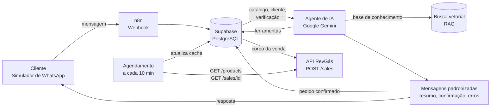

# RevGás – Chatbot de pedidos com n8n e Supabase

Projeto de Extensão VI (2026.2). O projeto atende a RevGás, revenda de gás de cozinha (GLP) e água mineral, com um chatbot que **faz a venda pelo WhatsApp**. Um banco de dados próprio funciona como cache da API da RevGás e deixa o atendimento mais rápido e seguro.

O bot conversa com o cliente, confere o estoque, monta o resumo com o preço oficial e registra o pedido. Ele também envia a venda para o sistema da revenda, confirma a identidade do cliente por PIN e chama um atendente humano quando precisa.

> **Canal:** a integração com a API oficial do WhatsApp (Meta) ficou bloqueada por exigências de cobrança da plataforma. A demonstração usa um **simulador de WhatsApp** (página HTML) que fala com o mesmo fluxo do n8n. Para ligar um canal real (Meta ou Twilio), basta trocar o nó de entrada e o de saída.

---

## Sumário
- [Arquitetura](#arquitetura)
- [O que o projeto entrega](#o-que-o-projeto-entrega)
- [Estrutura do repositório](#estrutura-do-repositório)
- [Tecnologias](#tecnologias)
- [Como rodar](#como-rodar)
- [Fluxo da conversa](#fluxo-da-conversa)
- [Banco de dados](#banco-de-dados)
- [Segurança e LGPD](#segurança-e-lgpd)
- [Análise das conversas](#análise-das-conversas)
- [Limitações e próximos passos](#limitações-e-próximos-passos)

---

## Arquitetura



- O **banco** é a fonte rápida de dados: catálogo, estoque, clientes, pedidos e memória da conversa.
- A **API RevGás** recebe as vendas. Estoque e status de entrega são copiados para o banco a cada 10 minutos, então o bot nunca espera a API para responder.
- A **IA** conversa e coleta dados. **Preço, total, regras de PIN e permissões ficam no banco**, não no prompt.

---

## O que o projeto entrega

| Requisito | Como foi atendido |
| --- | --- |
| **Banco de dados** | Schema `revgas` no Supabase, com clientes, endereços, produtos, pedidos, itens, mensagens, chamados, eventos de segurança e memória do agente. |
| **Migrar o n8n para o banco** | O fluxo lê e grava tudo no Postgres. A memória do agente também fica no banco (não se perde quando o n8n reinicia). |
| **Banco como cache da API** | Tabelas alinhadas à especificação OpenAPI da RevGás (`Product`, `Sale`, `SaleItem`, `Customer`). Sincronização automática de estoque e status. |
| **Reformular mensagens de pedido** | Resumo, confirmação, erros e pedido de PIN são **modelos fixos**, montados com os dados do banco. |
| **Segurança dos dados** | Usuário de banco com permissão mínima, RLS, consultas com parâmetros, telefone mascarado, LGPD (retenção e anonimização). |
| **Confirmação de identidade** | PIN de 4 dígitos (hash bcrypt), verificação válida por 30 minutos e bloqueio de 15 minutos após 3 erros. |
| **Falhas de segurança e de fluxo** | Tratadas: injeção de instruções, acesso a dados de outro número, pedido duplicado, estoque em falta, erro da API e entrada inválida. |
| **Necessidades das conversas** | Cada mensagem é gravada com a intenção, e há views de análise prontas. |

Também estão implementadas técnicas de IA conversacional: Tool Calling, RAG, Query Rewriting, Intent Classification, Entity Extraction, Conversation Memory, Human Handoff e Guardrails.

---

## Estrutura do repositório

```
banco/
  revgas_supabase.sql          # cria todo o banco (rode primeiro)
  views_painel.sql             # views de resumo para o SQL Editor
  view_tabelas_completas.sql   # view com todas as tabelas e colunas
  consultas_revgas.sql         # consultas de conferência e análise
  usar_views_painel.sql        # consultas prontas usando as views
n8n/
  revgas-chatbot-v4.json       # fluxo do n8n (importar)
simulador/
  simulador-revgas.html        # simulador de WhatsApp (abrir no navegador)
README.md
```

> Nenhum arquivo deste repositório contém senhas, tokens ou dados pessoais. As credenciais ficam só no n8n e no Supabase.

---

## Tecnologias

- **[n8n](https://n8n.io)** (Cloud): orquestração do fluxo, agente de IA e integrações.
- **[Supabase](https://supabase.com)** (PostgreSQL): banco de dados, RLS e funções em PL/pgSQL.
- **Google Gemini** (plano gratuito): modelo de linguagem e embeddings.
- **[API RevGás](https://revgas.stoplight.io)**: produtos, vendas e status de entrega.
- **HTML + JavaScript puro**: simulador de WhatsApp, sem dependências.

---

## Como rodar

### Pré-requisitos
- Conta no **n8n** (Cloud ou self-hosted) e no **Supabase**.
- Chave gratuita do **Gemini** ([Google AI Studio](https://aistudio.google.com)).
- **Token da API RevGás**, solicitado ao suporte da RevGás. Opcional: sem ele, o bot funciona só com o banco.

### 1. Banco (Supabase)
1. Crie um projeto no Supabase.
2. Abra `banco/revgas_supabase.sql`, troque `TROQUE_ESTA_SENHA` por uma senha forte (só letras e números) e rode tudo no **SQL Editor**.
3. Rode também `banco/views_painel.sql` e `banco/view_tabelas_completas.sql`.

O script cria o schema `revgas`, as tabelas, as funções, os produtos de exemplo e o usuário restrito `n8n_bot`. Ele pode ser rodado de novo sem apagar dados.

### 2. Credenciais no n8n
| Credencial | Tipo | Configuração |
| --- | --- | --- |
| Banco | **Postgres** | Em Supabase → **Connect** → **Session pooler**: Host do pooler, Port `5432`, Database `postgres`, User `n8n_bot.<PROJECT-REF>`, Password a do passo 1, SSL `Require`. No campo **CA Certificate**, cole o certificado de *Project Settings → Database → SSL Configuration*. |
| IA | **Google Gemini (PaLM) API** | Chave do Google AI Studio. |
| API RevGás | **Header Auth** | Name `Authorization`, Value o token (sem "Bearer"). |

> Use o **Session pooler**: a conexão direta do Supabase é só IPv6 e o n8n Cloud não alcança.

### 3. Fluxo
1. Importe `n8n/revgas-chatbot-v4.json` (**Workflows → Import from File**).
2. Abra os nós com alerta e escolha as credenciais.
3. Execute o gatilho **Carregar base de conhecimento**, para carregar os documentos da busca vetorial.
4. Execute o gatilho **A cada 10 minutos**, para trazer o estoque da API.
5. Clique em **Publish** e copie a **Production URL** do nó **Mensagem do simulador**.

O nó **Configuração** define se a venda é enviada à API RevGás (`enviar_venda_revgas`: `nao` ou `sim`).

### 4. Simulador
1. Abra `simulador/simulador-revgas.html` no navegador.
2. Cole a URL do webhook no painel da esquerda.
3. Escolha um cliente (cada um é um "número" diferente) e converse. Os botões à direita testam os cenários principais.

### 5. Conferir no banco
```sql
select * from revgas.v_resumo_tabelas;      -- quantos registros em cada tabela
select * from revgas.v_tabelas_completas;   -- todas as tabelas, todas as colunas
select * from revgas.v_intencoes;           -- o que os clientes mais pedem
```

---

## Fluxo da conversa

1. A mensagem chega e é **validada**: telefone com DDD e texto de até 1.000 caracteres.
2. O fluxo busca no banco o **catálogo com estoque** e a **situação do cliente**: novo, com PIN, verificado ou bloqueado.
3. O **agente** conversa e usa as ferramentas `verificar_pin`, `criar_pin`, `meus_dados`, `meus_pedidos` e `base_conhecimento`.
4. Com os dados completos, o sistema mostra o **resumo padronizado** com o preço do banco:
   ```
   📝 Resumo do seu pedido
   • 2x Botijão P13 (13 kg) — R$ 110,00 cada
   • Total: R$ 220,00
   • Pagamento: Dinheiro (troco para R$ 250,00)
   • Entrega: Rua das Flores, 120 – Fátima – Teresina/PI
   Responda SIM para confirmar ou me diga o que quer corrigir.
   ```
5. Depois do **SIM**, o fluxo confere a identidade, **registra o pedido no banco**, monta o corpo exato do `POST /sales`, envia à API e responde com a **confirmação padronizada** (número do pedido e código na RevGás).
6. Reclamação, pedido de atendente, vazamento de gás ou erro da API **abrem um chamado** para atendimento humano.
7. Toda mensagem é **registrada com a intenção**, para análise.

---

## Banco de dados

| Tabela | Conteúdo | Campo na API RevGás |
| --- | --- | --- |
| `clientes` | telefone, nome, hash do PIN, verificação, consentimento | `Customer` |
| `enderecos` | rua, número, bairro, cidade, UF, referência, CEP | `location`, `number`, `neighborhood`... |
| `produtos` | código, nome, preço, `api_product_id`, estoque (cache) | `Product.id`, `stock_quantity` |
| `pedidos` | status do bot, `status_revgas`, forma de pagamento, total, venda na API | `Sale` |
| `pedido_itens` | produto, quantidade, preço unitário, desconto | `SaleItem` |
| `mensagens` | histórico com intenção (90 dias) | — |
| `chamados` | pedidos de atendimento humano | — |
| `eventos_seguranca` | auditoria de PIN e bloqueios | — |
| `revgas_memoria.n8n_chat_histories` | memória do agente (7 dias) | — |

**Funções principais:** `registrar_pedido` (preço do banco, idempotência), `corpo_venda_api` (JSON exato do `POST /sales`, validado contra o schema oficial), `criar_pin` / `verificar_pin`, `consultar_cliente` / `consultar_pedidos` (só com verificação), `sincronizar_produtos` / `sincronizar_venda` (cache), `limpar_dados_antigos` e `anonimizar_cliente` (LGPD).

---

## Segurança e LGPD

**Medidas implementadas**
- **Menor privilégio:** o n8n usa o usuário `n8n_bot`, que não lê a tabela de clientes nem o hash do PIN, não altera preços e não apaga dados. Ele só executa funções específicas.
- **Regras no banco, não no prompt:** preço, total e acesso a dados pessoais são decididos por funções SQL. Mesmo que a IA seja enganada, o banco não entrega dados sem verificação.
- **Telefone vem do canal, nunca da IA:** as ferramentas usam o número da mensagem recebida, então ninguém consegue consultar dados de outro número pela conversa.
- **SQL parametrizado** em todos os nós (`$1`, `$2`), contra SQL injection.
- **PIN** guardado só como hash bcrypt. PINs fracos são recusados (1234, 0000, final do telefone), e há bloqueio de 15 minutos após 3 erros, com chamado para atendente.
- **Defesa contra injeção de instruções:** a mensagem do cliente entra delimitada e sem os delimitadores, e o prompt manda tratá-la como dado.
- **RLS** ligado em todas as tabelas. O schema `revgas` não fica exposto na API pública do Supabase.
- **Conexão criptografada** (SSL) com o banco.
- **Minimização de dados:** CPF, RG, sexo e data de nascimento, que existem na API, **não são guardados**.
- **Retenção:** mensagens por 90 dias, memória por 7 dias e auditoria por 180 dias (`limpar_dados_antigos`). Há anonimização a pedido do cliente (`anonimizar_cliente`).
- **Telefones mascarados** em todas as telas de consulta, como `(86) 9****-2233`.
- **Simulador** escapa todo texto recebido, contra XSS.

**Riscos conhecidos**
| Risco | Situação |
| --- | --- |
| O webhook do simulador é público e o telefone vem no corpo da requisição | Num canal real (Meta/Twilio), o número é garantido pelo provedor. No simulador, o **PIN** protege os dados. Próximo passo: exigir uma chave secreta no webhook. |
| PIN de 4 dígitos | É limitado por natureza, mas o bloqueio após 3 erros impede tentativa e erro. |
| Base de conhecimento em memória | Ela se perde se o n8n reiniciar. Próximo passo: usar pgvector no próprio Supabase. |

---

## Análise das conversas

```sql
select * from revgas.v_intencoes;        -- distribuição das intenções
select * from revgas.v_pedidos_por_dia;  -- pedidos, faturamento e erros de API por dia
select * from revgas.v_seguranca;        -- PINs criados, erros e bloqueios
```

As intenções classificadas são: `fazer_pedido`, `consultar_preco_estoque`, `status_pedido`, `duvida_politicas`, `seguranca_emergencia`, `reclamacao`, `falar_com_atendente`, `verificacao_identidade` e `saudacao_outros`.

---

## Limitações e próximos passos

- **Canal real:** ligar o WhatsApp oficial (Meta) quando a conta for liberada, ou usar o sandbox do Twilio.
- **Desempenho:** mover o Supabase para a região de São Paulo e juntar consultas para reduzir o tempo de resposta.
- **RAG persistente** com pgvector no Supabase.
- **Autenticação do webhook** com chave secreta.
- **Plano gratuito do Gemini:** tem limite de mensagens por minuto. Em produção, usar um plano pago.
- **Preços e políticas** (horário, troca, garantia) são **exemplos** e devem ser ajustados com a RevGás.

---

## Equipe

- *(adicione os nomes da equipe)*

Projeto de Extensão VI – 2026.2.