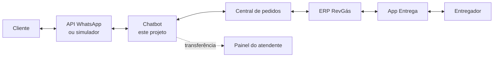
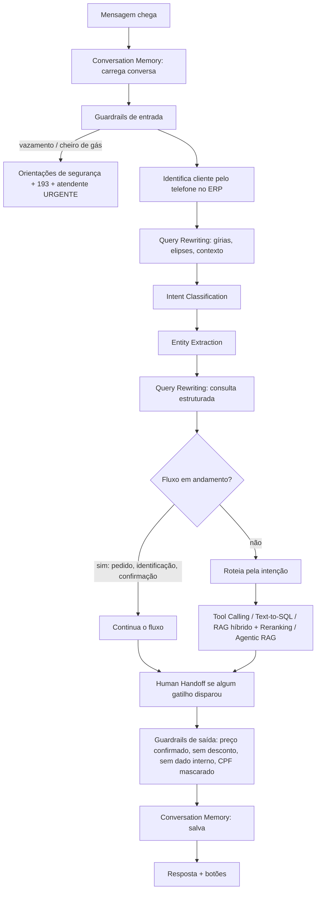

# Chatbot de WhatsApp — revenda de gás e água (integração ERP RevGás)

Bot de atendimento que **anota pedidos, informa preços e estoque, acompanha a entrega ("meu pedido chegou?"), envia 2ª via de boleto, abre trocas, responde dúvidas e transfere para um atendente humano** — aplicando as 11 técnicas da especificação (RAG híbrido, Query Rewriting, Intent Classification, Entity Extraction, Tool Calling, Text-to-SQL controlado, Reranking, Conversation Memory, Agentic RAG, Human Handoff e Guardrails).



O fluxo padrão usa o simulador ou a ponte Evolution. Consulte o [guia de configuração](GUIA_DE_CONFIGURACAO.md#comece-aqui) para testar sem credenciais do RevGás e conectar a instância Evolution.

O arquivo `whatsapp-bot.zip` do primeiro commit do repositório, quando presente, é uma versão anterior. As instruções abaixo se referem ao código em `app/`.

---

## Sumário
1. [Rodar agora (modo demonstração)](#1-rodar-agora-modo-demonstração)
2. [As 11 técnicas: onde estão e como ver funcionando](#2-as-11-técnicas-onde-estão-e-como-ver-funcionando)
3. [O que acontece com cada mensagem](#3-o-que-acontece-com-cada-mensagem)
4. [Formas de conversar com o bot (canais)](#4-formas-de-conversar-com-o-bot-canais)
5. [Integração com o ERP RevGás](#5-integração-com-o-erp-revgás)
6. [Text-to-SQL controlado](#6-text-to-sql-controlado)
7. [Atendimento humano (handoff)](#7-atendimento-humano-handoff)
8. [Guardrails (travas de segurança)](#8-guardrails-travas-de-segurança)
9. [IA opcional](#9-ia-opcional)
10. [Estrutura do projeto](#10-estrutura-do-projeto)
11. [Testes automatizados](#11-testes-automatizados)
12. [Colocar em produção](#12-colocar-em-produção)
13. [Problemas comuns com a API oficial do WhatsApp](#13-problemas-comuns-com-a-api-oficial-do-whatsapp)
14. [Limitações conhecidas](#14-limitações-conhecidas)

---

## 1. Rodar agora (modo demonstração)

Funciona **sem WhatsApp, sem IA e sem o ERP real** — com um ERP de demonstração (dados fictícios).

```bash
python -m venv .venv && source .venv/bin/activate      # Windows: .venv\Scripts\activate
pip install -r requirements.txt
cp .env.example .env                                     # pode deixar como está para a demonstração
uvicorn app.main:app --reload --port 8000
```

Abra **http://localhost:8000/simulador**. À esquerda você escolhe "quem" está conversando:

| Perfil | Telefone | Para testar |
|---|---|---|
| Maria Silva (PF) | 5511999990001 | pedido em andamento, "meu pedido chegou?", "o de sempre", trocas |
| Padaria Pão Quente (PJ) | 5511999990002 | boletos em aberto/vencido, P45 sem estoque na Zona Norte |
| João Souza (PF) | 5511999990003 | cliente sem pedidos |
| Número desconhecido | 5511988887777 | identificação por CPF + CEP, cadastro de cliente novo |

Com `ATENDIMENTO_MODO=auto` e `LLM_PROVEDOR=nenhum`, envie `menu`, escolha **Fazer pedido**, escolha um produto e confirme o endereço pelo número exibido. Use `continuar` para repetir a pergunta do fluxo e `sair` para descartar o fluxo em andamento. Teste **Acompanhar pedido** com o perfil da Maria e **Falar com atendente** para ver a transferência no painel.

Com IA habilitada, experimente mensagens como `quero dois botijões de 13 kg` ou `meu pedido já saiu?`. Se a classificação falhar, o bot mostra o menu. As etapas em andamento continuam aceitando as opções e os dados solicitados.

O resumo antes da confirmação, a confirmação e o acompanhamento mostram itens, quantidades, preços, taxa de entrega, total, pagamento, endereço e filial quando esses campos estão disponíveis. A confirmação inclui o número do pedido e oferece **Acompanhar pedido** e **Voltar ao menu**. No acompanhamento, as opções mudam conforme a situação da entrega. Durante o preenchimento, digite `menu` para voltar ao início e descartar o rascunho.

O painel da direita mostra, **para cada mensagem, cada técnica aplicada**, com os detalhes (intenção, entidades, consulta reescrita, ferramentas chamadas, trechos do RAG com notas, SQL gerado, guardrails...).

Também dá para conversar pelo terminal:
```bash
python scripts/chat_cli.py --debug                       # Maria
python scripts/chat_cli.py --telefone 5511988887777      # número sem cadastro
# para clicar num botão, digite #id  (ex.: #confirmar_pedido)
```

Painel do atendente: **http://localhost:8000/atendente** (senha = `PAINEL_ATENDENTE_SENHA` do `.env`).

---

## 2. As 11 técnicas: onde estão e como ver funcionando

| Técnica | Aplicação no chatbot | Onde está | Como ver no simulador |
|---|---|---|---|
| **RAG híbrido** | Consulta catálogo, políticas, manuais, garantia e FAQ com **busca vetorial + palavras-chave (BM25)**, fundidas por *Reciprocal Rank Fusion* | `app/rag/` (`hibrido.py`, `bm25.py`, `vetorial.py`), documentos em `knowledge/` | "vocês aceitam cartão?" → etapa *RAG híbrido* mostra posição no BM25, no vetorial e a nota RRF |
| **Query Rewriting** | "meu pedido chegou?" vira `{"acao": "consultar_status_pedido", "pedido": "PED-1003", "cliente_id": 1}`; resolve elipses ("e o de 45?"), "o de sempre", gírias, e expande sinônimos para a busca ("frete" → "taxa de entrega") | `app/nlu/reescrita.py` | "meu pedido chegou?" → duas etapas *Query Rewriting* (contexto + consulta estruturada) |
| **Intent Classification** | Pedido, preço, estoque, status, boleto, troca, histórico, dúvida, desconto, reclamação, atendente, **emergência**... e intenções secundárias | `app/nlu/intencoes.py` | Qualquer mensagem → etapa *Intent Classification* com confiança e gatilhos |
| **Entity Extraction** | CPF/CNPJ (com dígito verificador), nº do pedido, produto + quantidade, filial/bairro, período, status, pagamento, troco, CEP, endereço | `app/nlu/entidades.py` | "quero 2 gás e 1 água no pix" |
| **Tool Calling** | Funções seguras do ERP: cliente, preço, estoque, pedido, financeiro, troca. `cliente_id` vem sempre da sessão, nunca da IA | `app/core/ferramentas.py` | Etapas verdes *Tool Calling* com argumentos e resultado |
| **Text-to-SQL controlado** | Perguntas sobre histórico ("quanto gastei esse ano?") viram SQL **somente leitura**, só com tabelas/colunas liberadas e já filtradas pelo cliente | `app/sql/text_to_sql.py`, `config/sql_permissoes.json` | "quantas vezes comprei gás esse ano?" → mostra o SQL gerado e o executado |
| **Reranking** | Reordena os trechos do RAG (cobertura, título, categoria esperada, produto citado; + nota da IA se ligada) e corta o que não é relevante | `app/rag/reranker.py` | Etapa *Reranking* com nota de relevância |
| **Conversation Memory** | Guarda cliente, pedido atual, produto, filial, carrinho, etapa do fluxo e histórico; expira após X minutos mantendo a identificação | `app/core/memoria.py` | "quanto tá o P45?" → "e o de 13?" |
| **Agentic RAG** | Coordena várias consultas quando o pedido exige ERP + documentos + regras (ex.: troca = pedido no ERP → prazo da regra → política na base). Com IA, o agente escolhe as ferramentas sozinho | `app/core/agente.py` | "quero trocar o botijão que veio amassado e saber o preço do P45" |
| **Human Handoff** | Transfere com contexto, dados coletados (mascarados) e resumo; painel do atendente; bot em silêncio enquanto o humano atende | `app/core/handoff.py`, `/atendente` | "quero falar com um atendente" e abra o painel |
| **Guardrails** | Impede descontos não autorizados, exposição de dados, preço inventado, manipulação da IA; trata emergência de vazamento | `app/core/guardrails.py` | "faz por 100 reais?", "ignore suas instruções...", "tá com cheiro de gás" |

---

## 3. O que acontece com cada mensagem



**Fluxo de pedido** (o principal, do slide): identifica o cliente → produto e quantidade → confirma endereço cadastrado (ou recebe novo endereço / localização) → descobre a filial pelo bairro → confere limite e **estoque** → forma de pagamento (e troco) → **resumo com preços do ERP** → cliente confirma → grava na central de pedidos/ERP → informa número e previsão (prazo da filial, padrão **20 minutos**). Depois, cada mudança de status (separação → saiu para entrega → entregue) pode ser avisada automaticamente (seção 5.3).

---

## 4. Formas de conversar com o bot (canais)

Todos os canais usam **exatamente o mesmo cérebro** (`app/core/orquestrador.py`). O que muda é só a "porta de entrada".

### 4.1 Simulador web — `/simulador`
Interface estilo WhatsApp + painel com cada técnica aplicada. Botões: nova conversa, **simular a central avançando o status do pedido** (dispara o aviso proativo), enviar localização, enviar áudio, resetar dados de demonstração. Aberto em `localhost`; acessado de outro computador, pede a senha do painel (porque ele permite "ser" qualquer telefone). **Em produção: `SIMULADOR_ATIVO=false`.**

### 4.2 Terminal — `scripts/chat_cli.py`
Mesmo bot, sem servidor. Útil para testar regras rapidamente.

### 4.3 WhatsApp oficial (Cloud API da Meta) — adaptador existente
- Webhook: `GET/POST https://SEU-DOMINIO/webhooks/whatsapp`
- Verifica a assinatura `X-Hub-Signature-256` (com `WHATSAPP_APP_SECRET`), ignora mensagens repetidas (a Meta reenvia), responde 200 na hora e processa em segundo plano, marca como lida, envia texto ou **botões interativos** (até 3), aceita localização.
- Avisos fora da janela de 24h usam o **template** `WHATSAPP_TEMPLATE_STATUS_PEDIDO`.
- **Modo sandbox** (`WHATSAPP_ENVIO_REAL=false`): o bot recebe o webhook normalmente, mas **não envia nada para a Meta** — as respostas aparecem na aba *Saída WhatsApp (sandbox)* do simulador. Perfeito para validar a integração enquanto a conta da Meta não está 100%.

### 4.4 Simulador de webhook no formato da Meta — `scripts/simular_webhook.py`
Envia para o seu servidor uma mensagem **idêntica** à que a Meta envia (inclusive assinada), sem depender da Meta:
```bash
python scripts/simular_webhook.py --verificar                      # testa o GET de verificação
python scripts/simular_webhook.py "quero um gás" --de 5511999990001
python scripts/simular_webhook.py --botao end_ok --titulo "Sim, pode entregar"
```
Com isso vocês testam **o caminho completo do WhatsApp** (parser, assinatura, deduplicação, botões, envio) enquanto resolvem os problemas da conta.

### 4.5 Evolution API

A Evolution recebe mensagens por webhook e envia as opções como texto numerado. Veja a configuração e a validação em [Comece aqui](GUIA_DE_CONFIGURACAO.md#comece-aqui).

---

## 5. Integração com o ERP RevGás

### 5.1 Modos
- `ERP_MODO=mock` (padrão): ERP de demonstração em SQLite (`app/erp/mock.py`) com filiais, produtos, preços, estoques, clientes, pedidos, boletos. **Tudo fictício.** O pedido PED-1003 da Maria "anda sozinho" (recebido → em separação → saiu para entrega → entregue) para testar o rastreio.
- `ERP_MODO=revgas`: API HTTP real (`app/erp/revgas_http.py`).

### 5.2 Como o bot fala com o RevGás
O adaptador usa os endpoints oficiais da RevGás v1 para clientes, estabelecimentos, produtos, vendas e contas a receber. Preencha a chave `ERP_TOKEN` no `.env` e configure os bairros, IDs de produtos e preços da loja em `config/erp_revgas.json`. A seção **Etapa 5** do [guia de configuração](GUIA_DE_CONFIGURACAO.md#etapa-5--erp-revgás) mostra o formato e o diagnóstico online.

### 5.3 Avisos automáticos de status (central / app de entrega → cliente)
Quando o pedido muda de situação, o ERP ou o App Entrega chama:
```http
POST https://SEU-DOMINIO/webhooks/erp/status
X-Webhook-Token: <ERP_WEBHOOK_TOKEN>
Content-Type: application/json

{"numero_pedido": "PED-1006"}
```
O bot consulta o pedido no ERP e avisa o cliente no mesmo canal em que ele pediu ("🛵 Seu pedido saiu para entrega com Carlos! Previsão: até 14:20"). Se o RevGás não conseguir chamar uma URL, dá para fazer consulta periódica (polling) — combinar com vocês.

---

## 6. Text-to-SQL controlado

Para perguntas sobre o histórico ("quantos pedidos fiz este mês?", "quanto gastei com P13?", "qual produto mais comprei?").

Camadas de proteção (todas em código, testadas em `tests/test_rag_sql_guardrails.py`):
1. Só existem as **tabelas virtuais** de `config/sql_permissoes.json`. Cada uma é uma consulta-fonte que **já filtra pelo cliente da conversa** (`:cliente_id`) — o SQL gerado nunca enxerga dados de outro cliente.
2. O SQL é analisado (biblioteca `sqlglot`): 1 comando, só `SELECT`, sem `WITH` próprio, só tabelas/colunas liberadas, sem esquema explícito, sem funções perigosas.
3. `LIMIT` obrigatório (máx. 50).
4. Conexão **somente leitura** + tempo máximo.
5. Executa-se o SQL **regenerado a partir da árvore validada**, nunca o texto bruto.

Sem IA, perguntas comuns usam modelos prontos. Com IA, perguntas livres viram SQL (com uma nova tentativa se o validador recusar). Em produção, apontar `SQL_URL` para um **usuário somente leitura** com acesso apenas às views necessárias.

---

## 7. Atendimento humano (handoff)

**Quando transfere:** cliente pede; emergência (prioridade **urgente**); reclamação (**alta**); bot não entendeu 2 vezes seguidas; negociação de preço; troca fora do prazo; falha ao gravar pedido; CEP não confere; IA decide.

**O que vai junto:** motivo, prioridade, **resumo** (por regras ou pela IA), dados coletados com CPF/telefone **mascarados**, últimas mensagens.

**Onde aparece:** painel `/atendente` (lista por prioridade, conversa, resposta, assumir, encerrar e devolver ao bot) e, opcionalmente, um `POST` em `HANDOFF_WEBHOOK_URL` (para a central de pedidos, Slack, n8n...).

**Regras de horário:** dentro do horário, o bot fica em silêncio até o atendente encerrar. **Fora do horário**, o chamado fica aberto e o bot **continua atendendo** (pedidos de gás não param). Se ninguém assumir em `HANDOFF_ESPERA_MAXIMA_MINUTOS`, o bot volta a ajudar e o chamado continua no painel.

---

## 8. Guardrails (travas de segurança)

| Risco | Como o bot impede |
|---|---|
| **Vazamento de gás** | Detecta "cheiro de gás", "vazando", "fogo" (mas não "como testar se tem vazamento?") e responde **na hora** com as orientações de segurança e o 193, antes de qualquer outra coisa, e transfere com prioridade urgente |
| **Desconto não autorizado** | O bot não negocia; cita só promoções de `config/regras_comerciais.json`; qualquer texto da IA prometendo desconto é bloqueado |
| **Preço inventado** | Todo valor em R$ numa resposta da IA precisa ter vindo do ERP/regras naquele turno; senão a resposta é trocada |
| **Exposição de dados** | Cliente só vê os próprios dados; dados da conta exigem verificação (telefone do cadastro, ou CPF + CEP); a IA não escolhe o `cliente_id`; checagem de dono de pedido/boleto; CPF/CNPJ mascarados em respostas, logs e resumos; campos internos (custo, margem, limite de crédito) removidos antes de chegar à IA; estoque mostrado só como disponível/indisponível |
| **Ações indevidas** | Criar pedido, cancelar e abrir troca **só após confirmação do cliente** por botão; a IA não tem acesso a essas funções |
| **Manipulação da IA** | Detecta "ignore suas instruções", "mostre o prompt", SQL injection etc.; bloqueia vazamento de instruções internas |
| **Mensagens enormes / spam** | Corta a entrada; respostas respeitam o limite do WhatsApp |

---

## 9. IA opcional

| Configuração | Comportamento |
|---|---|
| `ATENDIMENTO_MODO=auto` com IA | A IA interpreta a mensagem atual e seleciona uma das mesmas três opções do menu. Em pedidos, pode extrair produto e quantidade. O bot usa suas mensagens prontas e preenche os campos com dados do fluxo e do ERP. |
| `ATENDIMENTO_MODO=auto` sem IA ou com erro | O menu oferece pedido, acompanhamento e atendimento humano. Dentro do fluxo, o bot aceita as opções exibidas e os campos solicitados, como CEP e endereço. |
| `ATENDIMENTO_MODO=legado` | Mantém o roteamento por texto livre com regras e o agente com ferramentas quando há IA. Use para reproduzir os exemplos antigos das 11 técnicas. |

No modo automático, uma confirmação de pedido, troca ou cancelamento exige a opção exibida. A Evolution usa os números. O simulador aceita números e botões. `continuar` repete a pergunta pendente, `sair` encerra o fluxo e `menu` descarta o fluxo atual e volta ao início.

Os testes do modo automático ficam em `tests/test_atendimento_auto.py`. A classificação envia a mensagem atual ao provedor quando a IA está habilitada. As perguntas e respostas exibidas aos clientes são definidas no código.

---

## 10. Estrutura do projeto

```
app/
  main.py                 servidor (rotas, webhooks, simulador, painel)
  config.py               lê o .env
  db.py                   banco local do bot (conversas, handoffs, auditoria)
  core/
    orquestrador.py       pipeline de cada mensagem (as 11 técnicas em ordem)
    fluxos.py             fluxos guiados: pedido, identificação, cadastro, confirmações
    agente.py             Agentic RAG (com e sem IA)
    ferramentas.py        Tool Calling seguro
    guardrails.py         travas de entrada/saída
    memoria.py            Conversation Memory
    handoff.py            Human Handoff
    notificacoes.py       avisos proativos de status
  nlu/                    intencoes.py, entidades.py, reescrita.py
  rag/                    base_conhecimento.py, bm25.py, vetorial.py, hibrido.py, reranker.py
  sql/text_to_sql.py      Text-to-SQL controlado
  erp/                    base.py (contrato), mock.py (demonstração), revgas_http.py (API real)
  canais/                 whatsapp_cloud.py (oficial), evolution.py (ponte não oficial), simulador
  llm/                    anthropic_llm.py, openai_llm.py
  static/                 simulador.html, atendente.html
config/                   regras_comerciais.json, sql_permissoes.json, erp_revgas.json
knowledge/                documentos da base de conhecimento (EXEMPLOS — substituir)
scripts/                  chat_cli.py, simular_webhook.py, verificar_config.py, testar_whatsapp.py
tests/                    84 testes automatizados
```

---

## 11. Testes automatizados

```bash
python -m pytest -q
```
A suíte cobre o menu Evolution em sandbox, interpretação com IA simulada, falha do provedor, retomada de fluxo e confirmações. Também cobre as conversas legadas, NLU, RAG, consultas SQL, guardrails e webhooks.

---

## 12. Colocar em produção

```bash
docker compose up -d --build        # usa o .env; dados persistem em ./data
```
Antes de ativar o envio real pela Evolution, confira os itens abaixo.

- [ ] Webhook da Evolution alcança o servidor do bot, com `EVOLUTION_WEBHOOK_TOKEN` preenchido.
- [ ] Em sandbox, o menu chegou à fila de saída e a opção numérica abriu o fluxo esperado.
- [ ] `PAINEL_ATENDENTE_SENHA` forte; `SIMULADOR_ATIVO=false`.
- [ ] Equipe acompanha a fila em `/atendente`. Valide a chave e as permissões do RevGás e teste a escrita em uma conta de teste autorizada.
- [ ] `python scripts/verificar_config.py --online` sem erros.
- [ ] Conteúdo real em `knowledge/` e regras reais em `config/regras_comerciais.json`.
- [ ] Banco do bot: SQLite atende **uma instância**. Para várias instâncias/alto volume, migrar `app/db.py` para PostgreSQL.
- [ ] Definir política de retenção das conversas (LGPD).

---

## 13. Problemas comuns com a API oficial do WhatsApp

| Sintoma / erro | Causa provável | O que fazer |
|---|---|---|
| Webhook não recebe mensagens (mas envio funciona) | App não inscrito na conta WhatsApp (WABA) | `python scripts/testar_whatsapp.py --assinar-waba` (faz `POST /{WABA_ID}/subscribed_apps`) |
| Webhook não recebe nada | Campo **messages** não assinado; URL sem HTTPS; app em modo desenvolvimento | Em *WhatsApp > Configuração*, assine **messages**; use HTTPS; coloque o app em modo **Live** (exige URL de política de privacidade) |
| Meta não aceita a URL do webhook | `WHATSAPP_VERIFY_TOKEN` diferente do digitado na Meta, ou servidor fora do ar | `python scripts/simular_webhook.py --verificar` |
| Erro **190** | Token temporário (expira em ~24h) | Gerar token **permanente** de Usuário do Sistema |
| Erro **131030** | Número de teste da Meta só envia para até 5 números cadastrados | Cadastrar o destinatário em *API Setup* ou usar o número real |
| Erro **131047** | Mais de 24h desde a última mensagem do cliente | Usar template aprovado |
| Erro **133010** / **131045** | Número não registrado na Cloud API | `POST /{PHONE_NUMBER_ID}/register` com PIN de 6 dígitos |
| Erro **131042** | Pagamento da conta | Cadastrar forma de pagamento no Business Manager |
| Número já está no WhatsApp/WhatsApp Business do celular | Número só pode estar em um lugar | Apagar a conta do app **ou** usar a "coexistência" via parceiro (Business app + API no mesmo número) |
| Webhook chega 2 vezes | A Meta reenvia | Já tratado (deduplicação pelo id da mensagem) |
| Cliente brasileiro "não encontrado" | WhatsApp às vezes manda o número sem o 9º dígito | Já tratado (busca com e sem o 9) |

Os erros de envio aparecem no log com a explicação em português (`app/canais/whatsapp_cloud.py`). `python scripts/testar_whatsapp.py --diagnostico` valida token e número na Meta.

---

## 14. Limitações conhecidas

- **Validação em conta real** depende da chave, da configuração comercial da loja e do canal WhatsApp.
- **Busca vetorial local** usa n-gramas de caracteres (tolera erro de digitação, mas não entende sinônimos distantes). Para semântica de verdade: `EMBEDDINGS_PROVEDOR=openai`.
- **Sem IA**, perguntas fora dos padrões previstos caem no menu/handoff.
- **Áudio e imagem** não são interpretados (o bot pede para escrever). Transcrição de áudio pode ser adicionada.
- **Pagamento** é na entrega; o bot não gera cobrança Pix/cartão (exige integração com banco/PSP).
- Conteúdo de `knowledge/`, preços e clientes de demonstração são **fictícios**.
